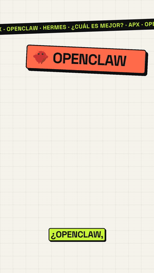
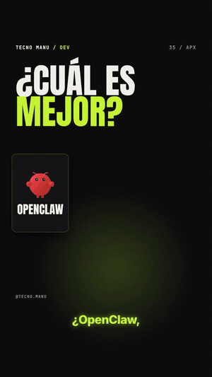
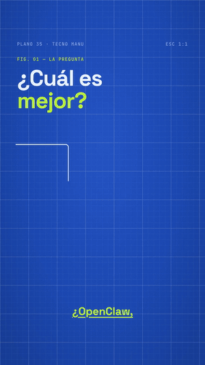
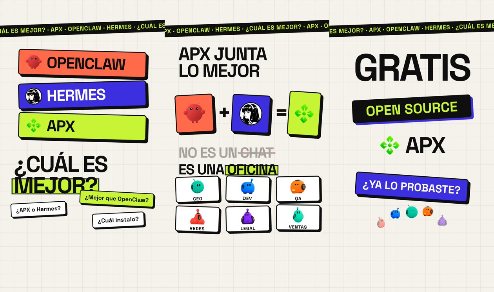
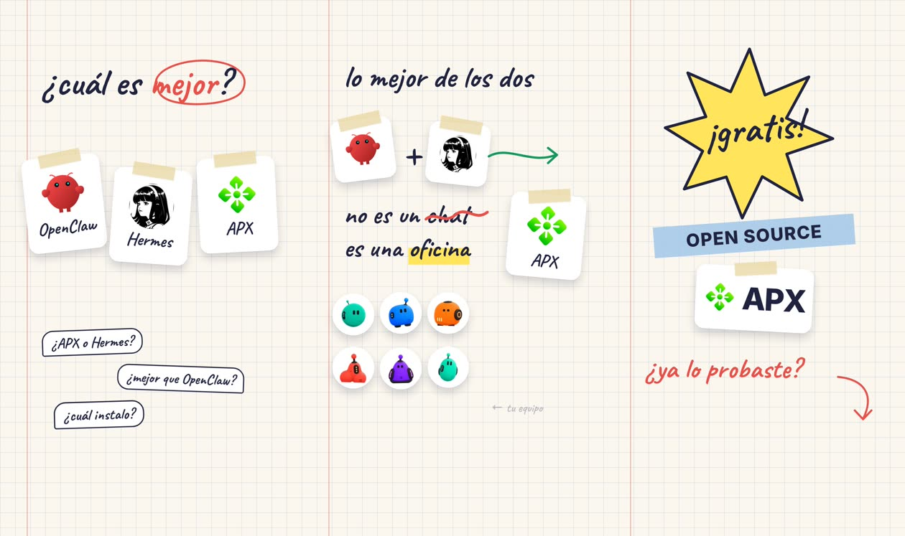
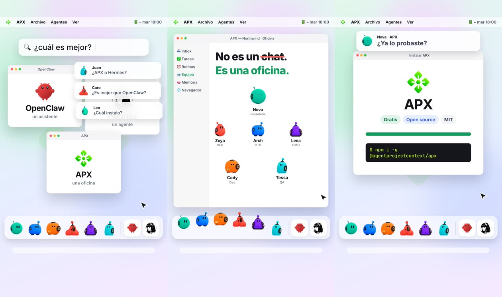
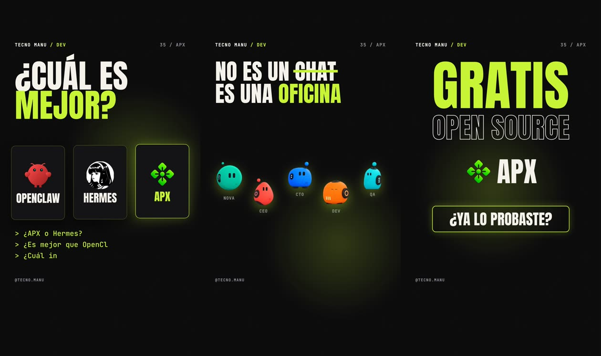
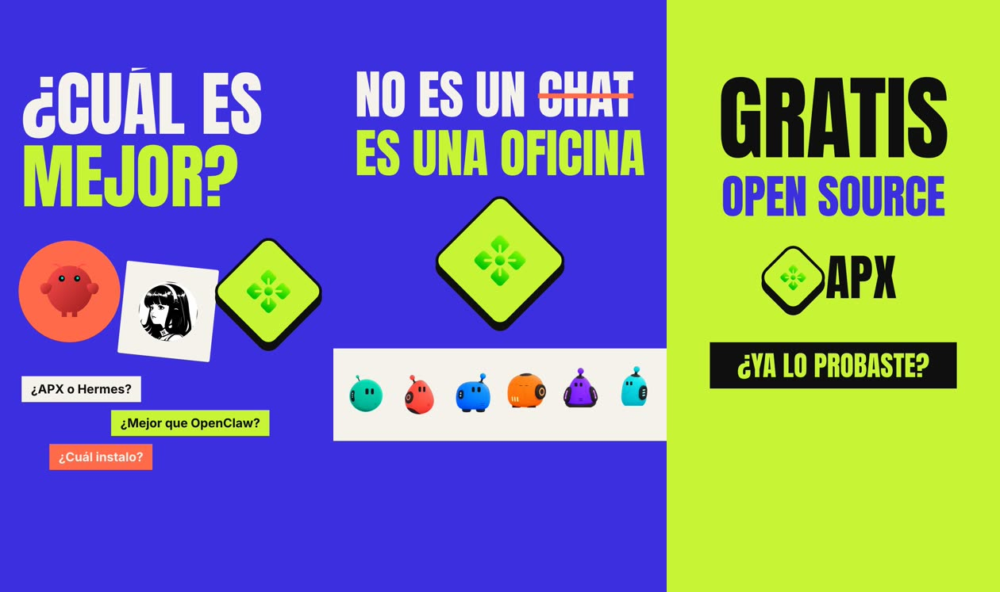
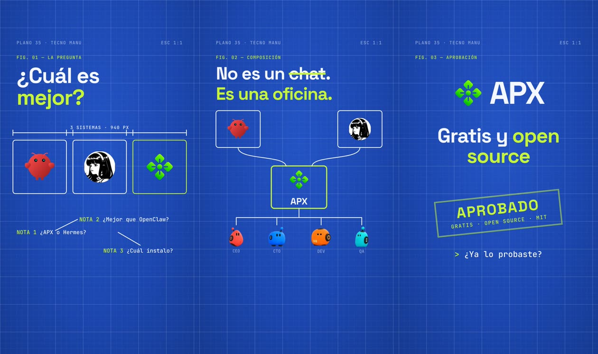

# motion-video-styles

An agent skill to make **animated vertical (9:16) or horizontal (16:9) videos** — reels, shorts, product
explainers — in **6 ready-made styles**, adapted to any brand. No camera and no video editor: scenes are
HTML animated with GSAP, every animation is cued to a spoken word, captions are karaoke-style, and the
render is deterministic (Playwright frame by frame → ffmpeg).

The skill walks the user from zero: brand, format, voice, style → a personal video kit folder → one
video after another.

## Three of the styles in motion

| stamp | neon-night | blueprint |
|:---:|:---:|:---:|
|  |  |  |

## The 6 styles

| Style | Preview |
|---|---|
| [**stamp**](skill/motion-video-styles/references/styles/stamp.md) · neo-brutalist light: bone paper, huge grotesk, black borders, hard shadows, two loud accents |  |
| [**notebook**](skill/motion-video-styles/references/styles/notebook.md) · stickers with tape, handwriting, marks that draw themselves, highlighter |  |
| [**desktop**](skill/motion-video-styles/references/styles/desktop.md) · the product as an OS: windows, dock, notifications, dialogs, cursor, installer |  |
| [**neon-night**](skill/motion-video-styles/references/styles/neon-night.md) · dark, one neon accent with glow, condensed type, 3D flips, glitch |  |
| [**poster**](skill/motion-video-styles/references/styles/poster.md) · full-bleed color that switches per scene, masked type, Bauhaus shapes |  |
| [**blueprint**](skill/motion-video-styles/references/styles/blueprint.md) · technical drawing: blue grid, line art, dimensions, schematics, stamp |  |

Previews come from one demo script rendered in every style (fictional data).

## Install the skill

```bash
git clone https://github.com/tecnomanu/motion-video-styles
# Claude Code (user-wide)
cp -R motion-video-styles/skill/motion-video-styles ~/.claude/skills/
# other agents: copy the folder to wherever your agent loads skills (e.g. .agents/skills/), or point it to SKILL.md
```

Then ask your agent: *"make me a reel kit with the motion-video-styles skill"*. It will ask for your
brand, format, voice and style, create `my-video-kit/` and guide each video.

**Requirements:** Node 20+, ffmpeg, Python 3 with `faster-whisper` (local word timestamps), and a TTS.
Recommended voice: [**QVox (qwen3-tts-api)**](https://github.com/tecnomanu/qwen3-tts-api) — local Qwen3-TTS
with cloneable voices, free; OpenAI, ElevenLabs or Piper also work. Captions are burned in, karaoke-style,
synced to the voice (`.srt` export included).

```bash
cp -R skill/motion-video-styles/engine my-video-kit && cd my-video-kit
npm i && npx playwright install chromium && pip install faster-whisper
```

## What's inside

```
skill/motion-video-styles/
├── SKILL.md                 workflow the agent follows (onboarding → kit → each video)
├── engine/                  the kit template: tts.py, transcribe.py, build_timings.py, scenes.html, common.js, render.mjs, make.sh, make_srt.py
└── references/
    ├── styles/<style>.md    tokens, components, motion signature, scene recipes per style
    ├── engine.md            scene API (cues, helpers, captions, languages, horizontal)
    ├── voice.md             QVox setup + other TTS, phonetic fixes, cleanup, QA
    ├── captions.md          how captions are built, styled per style, sized, positioned, exported to .srt
    └── music.md             where to find beds (Pixabay Music) and how loud to mix them
```

Music isn't bundled: the skill suggests royalty-free beds from
[Pixabay Music](https://pixabay.com/music/search/reels%20background/) for the user to download.

## Credits

Made by **tecnomanu** — [Instagram](https://instagram.com/tecno.manu) ·
[TikTok](https://www.tiktok.com/@tecno.manu) · [Bluesky](https://bsky.app/profile/tecno-manu.bsky.social) ·
[GitHub](https://github.com/tecnomanu)

MIT License.
